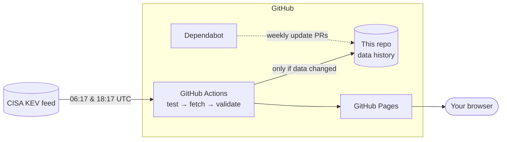

# Threat Radar

**Which software flaws are attackers exploiting right now?** This site answers
that question using CISA's
[Known Exploited Vulnerabilities (KEV) catalog](https://www.cisa.gov/known-exploited-vulnerabilities-catalog),
and it **updates itself twice a day** with no human involved.

- Summary of what's new this week and month, plus ransomware-linked entries
- A live radar of the last 30 days (newer = closer to the centre)
- Monthly trend and most-exploited vendors
- Search by CVE, vendor, product or keyword, with filters
- **Cyber Sitrep** section: the daily threat-intel bulletin with an archive, its CVEs cross-checked against KEV
- **Ransomware** section: the daily Breach Wire digest as statistics and threat-group intelligence (never victim names), plus KEV entries known to be used by ransomware
- No trackers, no cookies, no third-party code


## How it works



1. **GitHub Actions** ([`refresh-and-deploy.yml`](.github/workflows/refresh-and-deploy.yml)) wakes up on a schedule.
2. It runs all tests. If any fail, it stops and nothing is published.
3. [`scripts/fetch_kev.py`](scripts/fetch_kev.py) downloads the catalog and **validates** it. If the feed is broken, the old data stays live and the run turns red.
4. If the catalog changed, the new data is **committed**. Scroll the commit history to travel back in time.
5. The [`site/`](site) folder is published to **GitHub Pages**.
6. **Dependabot** checks weekly for updates to the Actions used here. The [Tests](.github/workflows/tests.yml) workflow checks each update before you merge.

## The Cyber Sitrep section

Every weekday a scheduled task emails the **📰 Cyber Sitrep**. A second scheduled
task (the *publisher*) reads that sent email, copies it into a small JSON file and
hands it to [`scripts/add_sitrep.py`](scripts/add_sitrep.py), the gatekeeper. The
gatekeeper validates it (https links only, length limits, no unknown fields),
detects CVE IDs itself and writes `site/data/sitrep/`. Pushing that triggers the
normal deploy. On the page, any CVE that is also in KEV gets an **In KEV** badge
that opens it on the Radar. Spec: [`specs/002-sitrep-section`](specs/002-sitrep-section).

## The Ransomware (Breach Wire) section

The daily **💥 Breach Wire** email lists ransomware leak-site claims. A third
scheduled task mirrors it as **numbers and group profiles only**. Before anything
is written, [`scripts/add_breachwire.py`](scripts/add_breachwire.py) checks that
the totals add up (by country, sector and group, plus the reconciliation) and runs
a **name guard**: the publisher hands it that day's victim names in a throwaway
file that is never committed, and any match refuses the whole issue. Spec:
[`specs/003-breach-wire-section`](specs/003-breach-wire-section).

## Security choices

| Threat | Defence |
|---|---|
| Malicious text in the feed | Feed text is only ever inserted as plain text (`textContent`), and a test fails if HTML-injection methods appear in the code |
| Injected scripts anyway | A strict Content-Security-Policy makes the browser refuse any code not from this site |
| Broken or truncated feed | Strict validation and a "shrink guard" (refuses a catalog that suddenly loses >10% of entries) |
| Hijacked GitHub Action | Every action is pinned to an exact commit hash, and Dependabot proposes updates only after a 7-day cooldown |
| Over-powered automation | Workflows start with zero permissions; each job gets only what it needs |

## Run it yourself

No installs needed: Python 3 and Node.js (any recent version) are enough.

```bash
# run every test
python3 -m unittest discover -s scripts -p "test_*.py" -v
python3 scripts/add_sitrep.py --check
python3 scripts/add_breachwire.py --check
node --test tests/stats.test.mjs tests/site.test.mjs tests/sitrep.test.mjs tests/breachwire.test.mjs

# refresh the data from CISA
python3 scripts/fetch_kev.py

# preview the site at http://localhost:8000
python3 -m http.server 8000 --directory site
```

## Project layout

```
.github/workflows/   the automation (refresh + deploy, tests on PRs)
.github/dependabot.yml
scripts/             fetch_kev.py + its tests
site/                the website (HTML, CSS, JS) and data/
tests/               JavaScript tests + fixtures (small sample feeds)
specs/               the spec, plan and task list this was built from
```

## Built with spec-driven development

This project was built from a written spec before any code existed. See
[`specs/001-threat-radar/`](specs/001-threat-radar): `spec.md` (what & why),
`plan.md` (how), `tasks.md` (the checklist) and `verification.md` (proof that
every acceptance criterion is met).

---

Data: CISA KEV catalog (US government work, public domain). Not affiliated with CISA.
