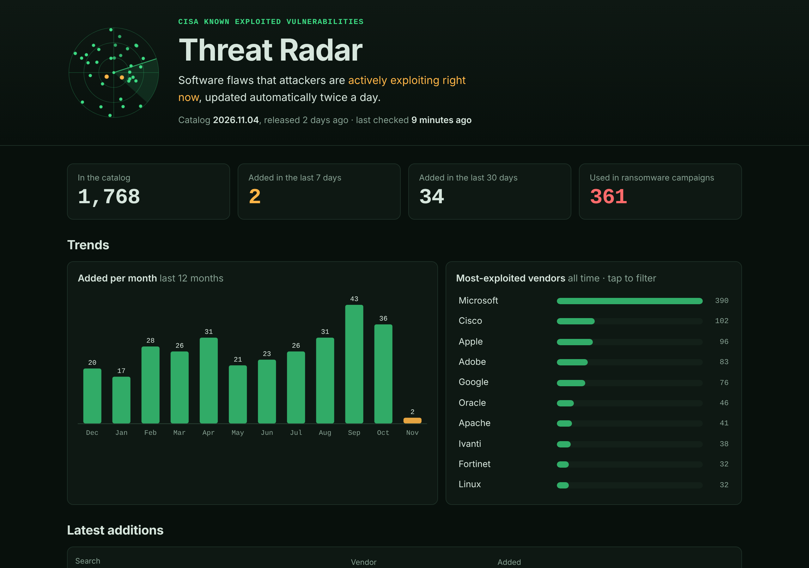

# Threat Radar

**Which software flaws are attackers exploiting right now?** This site answers
that question using CISA's
[Known Exploited Vulnerabilities (KEV) catalog](https://www.cisa.gov/known-exploited-vulnerabilities-catalog),
and it **updates itself twice a day** with no human involved.

- Summary of what's new this week and month, plus ransomware-linked entries
- A live radar of the last 30 days (newer = closer to the centre)
- Monthly trend and most-exploited vendors
- Search by CVE, vendor, product or keyword, with filters
- **Cyber Sitrep** section: the daily threat-intel bulletin with an archive, its CVEs cross-checked against KEV
- **Breaches** section (`/ransomware/`): the daily Breach Wire digest as statistics and threat-group intelligence (never victim names), plus KEV entries known to be used by ransomware
- **Feeds and Slack alerts**: Atom feeds for new KEV entries, the Sitrep, the Breach Wire and every vendor; a Feeds page; Slack messages to the owner's channel when something new is published
- **My stack**: tick the vendors and products you run, keep named presets, and every page highlights what affects you. It stays in your browser
- No trackers, no cookies, no third-party code



## How it works


1. **GitHub Actions** ([`refresh-and-deploy.yml`](.github/workflows/refresh-and-deploy.yml)) wakes up on a schedule.
2. It runs all tests. If any fail, it stops and nothing is published.
3. [`scripts/fetch_kev.py`](scripts/fetch_kev.py) downloads the catalog and **validates** it. If the feed is broken, the old data stays live and the run turns red.
4. If the catalog changed, the new data is **committed**. Scroll the commit history to travel back in time.
5. The [`site/`](site) folder is published to **GitHub Pages**.
6. **Dependabot** checks weekly for updates to the Actions used here. The [Tests](.github/workflows/tests.yml) workflow checks each update before you merge.

## The Cyber Sitrep section

Every weekday a scheduled task emails the **📰 Cyber Sitrep**. A second scheduled
task (the *publisher*) reads that sent email, copies it into a small JSON file and
hands it to [`scripts/add_sitrep.py`](scripts/add_sitrep.py), the gatekeeper. The
gatekeeper validates it (https links only, length limits, no unknown fields),
detects CVE IDs itself and writes `site/data/sitrep/`. Pushing that triggers the
normal deploy. On the page, any CVE that is also in KEV gets an **In KEV** badge
that opens it on the Radar. Spec: [`specs/002-sitrep-section`](specs/002-sitrep-section).

## The Breaches (Breach Wire) section

The daily **💥 Breach Wire** email lists ransomware leak-site claims. A third
scheduled task mirrors it as **numbers and group profiles only**. Before anything
is written, [`scripts/add_breachwire.py`](scripts/add_breachwire.py) checks that
the totals add up (by country, sector and group, plus the reconciliation) and runs
a **name guard**: the publisher hands it that day's victim names in a throwaway
file that is never committed, and any match refuses the whole issue. Spec:
[`specs/003-breach-wire-section`](specs/003-breach-wire-section).

## My stack

Visitors tick the vendors (or just some products) they run in the **My stack**
picker on the Radar. The Radar then rings matching blips, badges matching
entries, offers a "My stack only" filter and shows a summary, including **what's
new since your last visit**. The Sitrep tags matching CVEs and stories that
mention a ticked vendor, and the Breaches page lists the stack's
ransomware-linked vulnerabilities first.

- **Named presets** ("Work", "Home lab", "Customer A"); each keeps its own stack and "My stack only" setting.
- **Remember on this device** is off by default. Off, everything lives in `sessionStorage` and is gone when the tab closes. On, it moves to `localStorage`. Unticking deletes the stored copy at once, and "Forget everything" wipes both.
- **Nothing leaves the browser.** No cookies, no requests. A share link puts the stack after `#`, which browsers never send to a server, and opening one only *offers* to add it as a new preset.
- Logic is in pure, tested functions (`stack-logic.js`, `presets.js`); `stack-store.js` is the only file that touches storage.

Spec: [`specs/004-my-stack`](specs/004-my-stack).

## Feeds and Slack alerts

Every deploy builds **Atom feeds** from the published data (`scripts/build_feeds.py`;
they're never committed):

| Feed | What's in it |
|---|---|
| `feeds/kev.xml` | The 50 newest exploited vulnerabilities |
| `feeds/sitrep.xml` | The 30 latest Cyber Sitrep issues |
| `feeds/breachwire.xml` | The 30 latest Breach Wire issues, statistics only |
| `feeds/vendors/<vendor>.xml` | Each vendor's 20 newest entries (`feeds/vendors.json` lists them all) |

The **Feeds page** (`/feeds/`) explains how to use them in feed readers, Slack's RSS
app, Zapier, n8n and Power Automate. In the My stack picker, **"Subscribe in a feed
reader"** builds an OPML file in the browser with one feed per ticked vendor.

After each successful deploy, `scripts/notify_slack.py` posts what's new to the
owner's Slack channel: new KEV entries (up to 10 listed), a new Sitrep, a new Breach
Wire. A git tag, `alerts-sent`, marks how far the alerts have got. To set it up,
create a Slack incoming webhook and save it as the repository secret
`SLACK_WEBHOOK_URL`. Then run the workflow by hand with **"Send a test message to
Slack"** ticked. Without the secret, alerts are simply skipped.

Spec: [`specs/005-feeds-and-alerts`](specs/005-feeds-and-alerts).

## Security choices

| Threat | Defence |
|---|---|
| Malicious text in the feed | Feed text is only ever inserted as plain text (`textContent`), and a test fails if HTML-injection methods appear in the code |
| Injected scripts anyway | A strict Content-Security-Policy makes the browser refuse any code not from this site |
| Broken or truncated feed | Strict validation and a "shrink guard" (refuses a catalog that suddenly loses >10% of entries) |
| Hijacked GitHub Action | Every action is pinned to an exact commit hash, and Dependabot proposes updates only after a 7-day cooldown |
| Over-powered automation | Workflows start with zero permissions; each job gets only what it needs |
| Data text sneaking markup into a feed, or `@channel` / fake links into Slack | Feeds are written by an XML library after removing forbidden characters; Slack text is escaped so `<!channel>` shows as plain text, and link previews are off |
| The Slack webhook address leaking | Only in a GitHub secret, visible to two steps of one job, never printed; the script only accepts `https://hooks.slack.com/` addresses |
| A visitor's software list (handy reconnaissance) | Kept only in their own browser, never in a cookie, request or the repo; stored or shared stacks are strictly validated and shown as text |

## Run it yourself

No installs needed: Python 3 and Node.js (any recent version) are enough.

```bash
# run every test
python3 -m unittest discover -s scripts -p "test_*.py" -v
python3 scripts/add_sitrep.py --check
python3 scripts/add_breachwire.py --check
node --test tests/stats.test.mjs tests/site.test.mjs tests/sitrep.test.mjs tests/breachwire.test.mjs tests/stack.test.mjs tests/presets.test.mjs tests/stack-store.test.mjs tests/opml.test.mjs

# refresh the data from CISA
python3 scripts/fetch_kev.py

# preview the site at http://localhost:8000
python3 -m http.server 8000 --directory site
```

## Project layout

```
.github/workflows/   the automation (refresh + deploy, tests on PRs)
.github/dependabot.yml
scripts/             fetch_kev.py + its tests
site/                the website (HTML, CSS, JS) and data/
tests/               JavaScript tests + fixtures (small sample feeds)
specs/               the spec, plan and task list this was built from
```

## Built with spec-driven development

This project was built from a written spec before any code existed. See
[`specs/001-threat-radar/`](specs/001-threat-radar): `spec.md` (what & why),
`plan.md` (how), `tasks.md` (the checklist) and `verification.md` (proof that
every acceptance criterion is met).

---

Data: CISA KEV catalog (US government work, public domain). Not affiliated with CISA.
