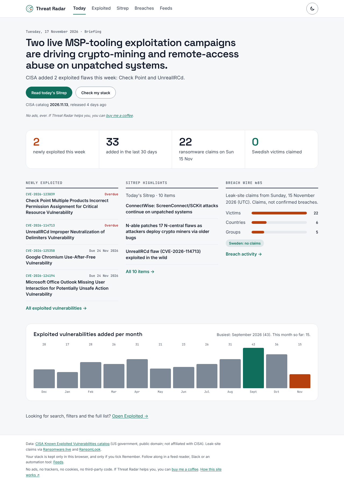
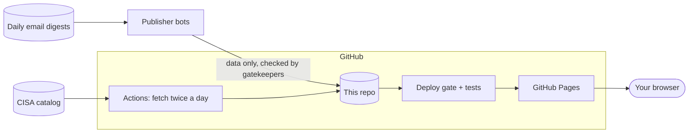

# Threat Radar

**Which software flaws are attackers exploiting right now?** A daily cyber threat
briefing at **[zelin.se](https://zelin.se)**, built on CISA's
[Known Exploited Vulnerabilities catalog](https://www.cisa.gov/known-exploited-vulnerabilities-catalog)
and updated automatically, with no human in the loop.



| Page | What it shows |
|---|---|
| **Today** | A morning briefing: the day's headline, key numbers, newest exploited flaws, Sitrep highlights, ransomware activity |
| **Exploited** | The full catalog with a live radar, trends, search and filters |
| **Sitrep** | The daily Cyber Sitrep, with its CVEs checked against the catalog |
| **Breaches** | Ransomware leak-site activity as statistics and group profiles, never victim names |
| **Feeds** | Atom feeds for readers, Slack and automation tools, including one per vendor |

Also: **My stack** (tick the software you run and every page highlights what affects
you; it never leaves your browser), light and dark mode, and no ads, trackers,
cookies or third-party code.

## How it works



- **CISA data** is fetched and validated twice a day by [GitHub Actions](.github/workflows/refresh-and-deploy.yml).
- **The Sitrep and Breach Wire** are mirrored from daily emails by scheduled publisher bots. Gatekeeper scripts ([`add_sitrep.py`](scripts/add_sitrep.py), [`add_breachwire.py`](scripts/add_breachwire.py)) refuse anything malformed, and any victim name.
- **Before every deploy**, a [deploy gate](scripts/deploy_gate.py) checks that the bots only changed their own data, and all tests run. If anything fails, nothing is published.
- **The site** is plain HTML, CSS and JavaScript in [`site/`](site): no framework, no build step.

## Security

The page code runs under a strict Content Security Policy, shows all data as plain
text, and loads nothing from other servers. The automation uses pinned actions with
minimal permissions, and the deploy gate keeps the bots in their lane.

Found a problem? Please report it privately: see [SECURITY.md](SECURITY.md).
Taking part in issues or pull requests? See the [code of conduct](CODE_OF_CONDUCT.md).

## Run it yourself

Python 3 and Node.js are enough; nothing to install.

```bash
npm test                                              # page tests
python3 -m unittest discover -s scripts -p "test_*.py"   # script tests
python3 scripts/fetch_kev.py                           # refresh the data from CISA
python3 -m http.server 8000 --directory site           # preview at http://localhost:8000
```

## Project layout

```
site/        the website and its data
scripts/     fetching, gatekeepers, feeds, deploy gate, Slack alerts (with tests)
tests/       page tests
specs/       how each feature was specified, planned and verified
.github/     the automation
```

## How it was built

Every feature started as a written spec, then a plan, tests, the code, and a
verification report. [`specs/`](specs) lists them all, with what each one changed.

---

Data: CISA KEV catalog (US government work, public domain); leak-site statistics via
[Ransomware.live](https://www.ransomware.live/) and [RansomLook](https://www.ransomlook.io/).
Not affiliated with CISA.
