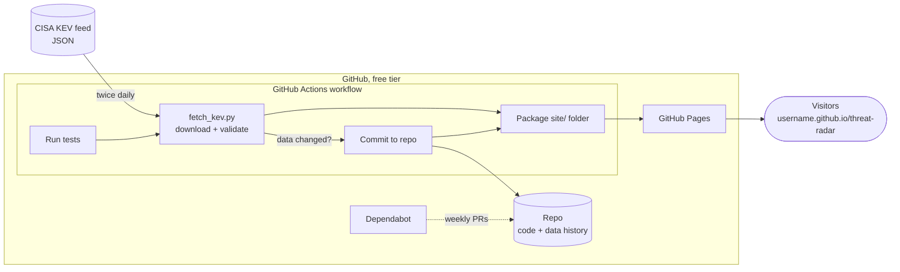

# Implementation plan: Threat Radar

| | |
|---|---|
| **Spec** | [spec.md](./spec.md) |
| **Status** | Approved 2026-11-06 · Updated after build, see §7 |

> This file is the **how**. Every choice below traces back to a requirement in
> `spec.md` (shown in brackets, like [FR-2]).

---

## 1. Architecture at a glance



*(GitHub renders this diagram automatically when you view the file on github.com.)*

## 2. Technology choices and why

| Choice | Why | Traces to |
|---|---|---|
| **Python 3, standard library only** for the fetch script | Python is preinstalled on GitHub's runners. Zero dependencies means zero supply-chain risk and nothing to install. | NFR-3, NFR-4 |
| **Plain HTML + CSS + vanilla JavaScript**, no framework, no build step | Easiest to read and learn from. Nothing to compile, no `node_modules`. | NFR-1, NFR-5 |
| **Charts drawn with hand-written SVG** in JS (no chart library) | Keeps the "no third-party scripts" promise. | NFR-1 |
| **One workflow file** that does test, fetch, commit, then deploy | One place to look and one log to read when something breaks. | FR-1, FR-3 |
| **Pages source = "GitHub Actions"** using the official `upload-pages-artifact` and `deploy-pages` actions | This is the modern deploy method. The site deploys in the same run that fetched the data. | AC-1 |
| **Content-Security-Policy `<meta>` tag** with `default-src 'self'` | The browser itself refuses to load anything from other domains. | NFR-1, AC-7 |
| **DOM built with `textContent`, never `innerHTML`**, for feed data | Feed text can never become live HTML or script. | NFR-2, AC-6 |

## 3. How the automation works

**Triggers** [AC-9]
- `schedule`: twice daily at 06:17 and 18:17 UTC. The odd minute avoids GitHub's busy top-of-the-hour queue.
- `workflow_dispatch`: adds the "Run workflow" button in the Actions tab [FR-10].
- `push` to `main`: when site code changes, the site redeploys.

**Job 1: `refresh`** (permission: `contents: write` only)
1. Check out the repo.
2. Run the test suite (Python `unittest` + Node's built-in `node --test`). If any test fails, **stop here** and publish nothing.
3. Run `fetch_kev.py`:
   - It downloads the feed and validates it. Validation checks that the result is JSON, that it has a `vulnerabilities` list, that the count is plausible (not empty) and that every entry has the required fields.
   - If validation fails, the script exits with an error and the run turns red. Existing files are not touched [FR-2, AC-2].
   - Otherwise it writes `site/data/kev.json`, sorted newest first and trimmed to the fields the site uses, plus `site/data/meta.json` (catalog version, release time, count).
   - It also writes `site/data/status.json` (time of this check). This file is in `.gitignore`, so it is published with the site but never committed. That gives us a fresh "last checked" time **without** a commit every run [FR-4, AC-3].
4. If `git diff` shows changes, commit with the message `data: KEV catalog <version>` and push [FR-3]. Otherwise skip [AC-3].
5. Upload the `site/` folder as the Pages artifact.

**Job 2: `deploy`** (permissions: `pages: write`, `id-token: write` only)
1. Deploy the artifact to GitHub Pages.

**Why the bot's commit doesn't cause an infinite loop:** pushes made with the
workflow's built-in `GITHUB_TOKEN` intentionally don't trigger new workflow
runs. That's a GitHub safety feature.

**Safety rails**
- The top-level `permissions: {}` means the workflow starts with no permissions. Each job then gets only what it needs [NFR-3].
- `concurrency: pages` ensures two runs never deploy at the same time.
- Actions are pinned to full commit SHAs with a version comment. Dependabot bumps them weekly [NFR-3, FR-11].

## 4. File layout

```
threat-radar/
├── .github/
│   ├── workflows/refresh-and-deploy.yml   # the robot
│   ├── workflows/tests.yml                # tests on every pull request
│   └── dependabot.yml                     # keeps actions updated
├── scripts/
│   ├── fetch_kev.py                       # download + validate + write data
│   └── test_fetch_kev.py                  # tests for the above
├── tests/
│   ├── fixtures/                          # small sample feeds: valid, broken, booby-trapped
│   ├── stats.test.mjs                     # tests for the site's number crunching
│   └── site.test.mjs                      # static safety checks (no HTML injection, CSP)
├── site/                                  # everything that gets published
│   ├── index.html
│   ├── styles.css
│   ├── app.js                             # rendering, search, filters, charts
│   ├── stats.js                           # pure functions: counts, groupings
│   ├── favicon.svg
│   └── data/
│       ├── kev.json                       # committed (history!)
│       ├── meta.json                      # committed
│       └── status.json                    # NOT committed (last-checked time)
├── specs/001-threat-radar/                # spec, plan, tasks, verification
├── package.json                           # tells Node .js files are modules (no dependencies)
├── .gitignore
└── README.md                              # what it is + how it works, with diagram
```

## 5. Data contract

**`site/data/meta.json`** (committed)
```json
{ "catalogVersion": "2026.11.04", "dateReleased": "2026-11-04T20:00:05.774Z", "count": 1768 }
```

**`site/data/status.json`** (published, not committed)
```json
{ "checkedAt": "2026-11-06T18:17:44Z", "source": "https://www.cisa.gov/sites/default/files/feeds/known_exploited_vulnerabilities.json" }
```
`source` lives here, not in `meta.json`, so switching between the primary feed
and the mirror never creates a commit on its own.

**`site/data/kev.json`** is an array sorted by `dateAdded` (newest first),
then by `cveID`. Each entry keeps CISA's original field names, so the data
stays recognizable:

| Field | Required | Example |
|---|---|---|
| `cveID` | yes | `CVE-2021-44228` |
| `vendorProject` | yes | `Apache` |
| `product` | yes | `Log4j2` |
| `vulnerabilityName` | yes | `Apache Log4j2 Remote Code Execution Vulnerability` |
| `dateAdded` | yes | `2021-12-10` |
| `shortDescription` | yes | text |
| `requiredAction` | yes | text |
| `dueDate` | yes | `2021-12-24` |
| `knownRansomwareCampaignUse` | yes | `Known` or `Unknown` |
| `notes` | no | text / URLs separated by ` ; ` |
| `cwes` | no | `["CWE-20", "CWE-400"]` |
| `forensicTriage` | no | `Yes` or `No` (new CISA field, found in the real feed during build) |

**Where the numbers are computed:** date-relative stats like "last 7 days" are
computed **in the browser** against today's date. They are always correct even
if the catalog hasn't changed in a while. That logic lives in `stats.js` as
pure functions, so it can be tested automatically [AC-4].

## 6. Testing strategy (tests written before code)

| Test | Proves |
|---|---|
| Valid fixture produces correctly sorted, trimmed output | FR-1, data contract |
| Broken JSON, missing `vulnerabilities`, empty list, or entry missing `cveID` each makes the script exit non-zero with no files written | AC-2 |
| Running twice on the same input produces byte-identical files, so git sees no change | AC-3 |
| `stats.js` counts match a hand-computed answer on a fixture | AC-4 |
| Search and vendor filter functions return the right subsets | AC-5 |
| Booby-trapped fixture (`<script>alert(1)</script>` in description) survives as literal text in output, and the rendering code contains no `innerHTML` | AC-6 |
| CSP meta tag is present with `default-src 'self'` | AC-7 |
| Visual check at 360 px and 1280 px in a real browser | AC-8, NFR-6 |

## 7. Changes made during the build

Reality taught us a few things the original plan didn't know. Each change keeps
the spec's intent and is covered by tests.

| # | Change | Why |
|---|---|---|
| 1 | **Fallback source**: if cisa.gov fails, use CISA's official GitHub mirror (`cisagov/kev-data`) | cisa.gov was unreachable from the build sandbox, so a second official source makes FR-1 more robust |
| 2 | **New optional field `forensicTriage`**, shown as a badge in the detail view | Present in the real feed (BOD 26-04) but not in our original contract |
| 3 | **Vendor dropdown** next to the search box (and the vendor chart filters it) | On real data, free-text "Microsoft" also matches 61 other vendors' descriptions. An exact vendor filter makes AC-5 precise |
| 4 | **Exact CVE ID match is listed first** | Verification showed `CVE-2021-44228` listing a later Log4j bug first because its description mentions the ID |
| 5 | **Shrink guard**: refuse a catalog that lost >10% of its entries | Extra protection for FR-2. It also caught a real mistake during verification |
| 6 | **Second workflow `tests.yml`** runs tests on every pull request | So Dependabot's auto-updates are tested before you merge them (FR-11) |
| 7 | **Dependabot 7-day cooldown** | Avoids adopting a just-published (possibly compromised) action version |
| 8 | **`package.json`** with `"type": "module"` and no dependencies | Lets Node run the same `stats.js` file the browser uses |

## 8. Risks and mitigations

| Risk | Mitigation |
|---|---|
| CISA changes the feed format | Validation fails loudly, old data stays live, and the run turns red in the Actions tab |
| GitHub pauses scheduled workflows in public repos after 60 days of no repo activity | CISA adds entries most weeks, so data commits should keep the repo active. If it ever pauses, GitHub shows a banner and one click (or a manual run) re-enables it |
| A pinned action has a security fix | Dependabot opens a PR within a week |
| Feed contains malicious text | CSP + `textContent`-only rendering (two independent layers) |
