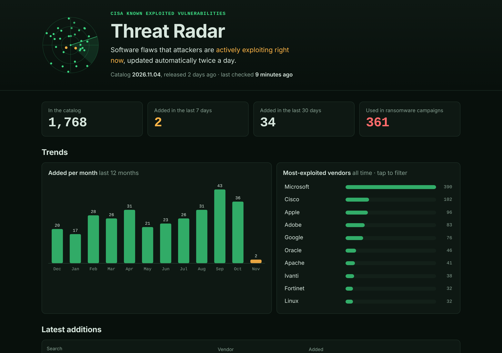

# Verification report: Threat Radar

| | |
|---|---|
| **Spec** | [spec.md](./spec.md) |
| **Verified** | 2026-11-06, against the real CISA catalog v2026.11.04 (1,768 entries) · **All 10 acceptance criteria pass** |
| **Test suite** | 21 Python tests + 18 JavaScript tests, **39/39 passing** |
| **Browser** | Headless Chrome, 1280 px and 360 px, dark and light themes |

## Acceptance criteria

| AC | Result | Evidence |
|---|---|---|
| **AC-1** Site live after a workflow run | ✅ Pass | Manual run #2 (`workflow_dispatch`, also proving FR-10): all steps green. Live at https://smashytech.github.io/threat-radar/ with catalog 2026.11.04, 1,768 entries, fetched directly from cisa.gov, 0 console errors, 0 external requests |
| **AC-2** Bad feed fails the run, published data unchanged | ✅ Pass | `BadFeedsChangeNothing`: 9 tests (broken JSON, missing field, empty list, unreachable, no list, not an object, bad date, bad CVE, duplicate) each confirm exit code ≠ 0 **and** files untouched. `ShrinkGuard` refuses a >10% drop |
| **AC-3** Unchanged feed means no commit | ✅ Pass | Live run log: "Catalog unchanged. Nothing to commit." Also `Determinism.test_identical_output`: two runs give byte-identical `kev.json`/`meta.json`. The workflow commits only when `git diff --cached` is non-empty, and the run timestamp lives in the git-ignored `status.json` |
| **AC-4** Card numbers match an independent recount | ✅ Pass | `stats.test.mjs`: "summary cards" (hand-counted) + "summary agrees with an independent recount" |
| **AC-5** CVE search finds Log4j; vendor search shows only that vendor | ✅ Pass | Unit tests + browser: `CVE-2021-44228` lists Log4j **first**. Vendor "Microsoft" gives 390 results, 100% Microsoft (checked across the first 50 rows) |
| **AC-6** `<script>` in feed shows as text, never runs | ✅ Pass | Browser with booby-trapped data: description displayed literally, **0** injected elements, **0** alerts fired ([screenshot](./evidence/xss-detail.png)). `site.test.mjs` bans HTML-injection APIs in the code |
| **AC-7** Page blocks requests to other domains | ✅ Pass | CSP `default-src 'self'` verified by `site.test.mjs`. Browser network log: **0** external requests |
| **AC-8** No horizontal scroll at 360 px | ✅ Pass | Measured `scrollWidth − clientWidth = 0` (dark, light, and with the detail dialog open) ([screenshot](./evidence/mobile-dark-list.png)) |
| **AC-9** Schedule (≥ daily) + manual trigger | ✅ Pass | `refresh-and-deploy.yml`: `cron: "17 6,18 * * *"` + `workflow_dispatch` |
| **AC-10** Dependabot watching GitHub Actions | ✅ Pass | `.github/dependabot.yml`: `github-actions`, weekly, 7-day cooldown |

## Non-functional checks

| NFR | Result | Evidence |
|---|---|---|
| NFR-1 No third-party code | ✅ | `index.html` loads only local files; 0 external requests in browser |
| NFR-2 Text never becomes HTML | ✅ | See AC-6 |
| NFR-3 Least privilege, pinned actions | ✅ | `permissions: {}` at top; per-job grants; all actions pinned to commit SHAs |
| NFR-4 $0 | ✅ | Public repo, GitHub free tier, no keys |
| NFR-5 Under 1 MB compressed | ✅ | `kev.json` is 1.43 MB raw / **188 KB gzipped**; HTML+CSS+JS about 40 KB raw |
| NFR-6 360 px to desktop | ✅ | See AC-8 |
| NFR-7 Keyboard + both themes | ✅ | Native buttons/inputs/`<dialog>` (Esc closes, verified), visible focus ring, skip link, light and dark screenshots checked |

## Issues found during verification (all fixed, with tests)

1. **Exact CVE search ranked second.** Searching `CVE-2021-44228` listed the later Log4j bug CVE-2021-45046 first, because its description mentions the original ID. Fixed: an exact ID match now always goes first (new test).
2. **Search box about 240 px tall on phones.** When the controls stack in a column, `flex-basis` set the height instead of the width. Fixed in CSS and re-measured.
3. **Uneven vendor bars, wrapping dates.** Fixed with a fixed-width count column and no-wrap dates.
4. **The shrink guard fired on my own test setup.** That's a mistake caught by a safety rail, which counts as evidence the rail works.

