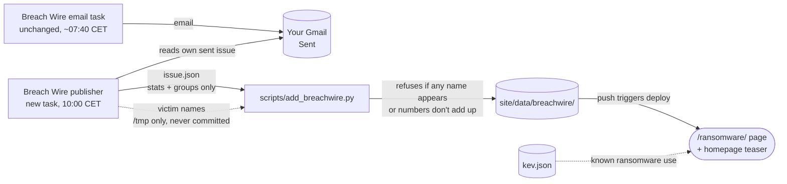

# Implementation plan: Breach Wire section

| | |
|---|---|
| **Spec** | [spec.md](./spec.md) |
| **Status** | Draft, awaiting owner review |

## 1. Architecture

Same pattern as spec 002, with one extra safety rail: the victim-name guard.



## 2. The victim-name guard (FR-2)

1. The issue format has **no field for victims**. It only holds counts, groups and quality numbers.
2. For each issue, the publisher also writes `/tmp/bw-victims-<date>.txt`, one
   name per line, covering every victim in the email (rows, late-to-press, reposts
   and any victim named in the ledger). That file lives only in the run's temporary
   sandbox and is never committed.
3. It runs `add_breachwire.py issue.json --forbid /tmp/bw-victims-<date>.txt`.
   The gatekeeper:
   - requires `--forbid` when publishing;
   - requires at least as many names as the issue's victim count (so the list can't be skipped);
   - refuses the issue if **any** name of 4+ characters appears anywhere in it
     (case-insensitive, punctuation ignored).
4. Ledger profiles are copied with any sentence that names a victim removed.
   Groups that only appear through reposts or masked postings (0 new victims)
   are left out of the ledger.

## 3. Data contract

**`issue.json`** (written by the publisher, checked by the gatekeeper)
```json
{
  "date": "2026-11-06",
  "issue": 75,
  "window": "2026-11-05",
  "stats": { "victims": 16, "groups": 11, "countries": 5, "regions": 4 },
  "sweden": 0,
  "regions": [
    { "region": "North America", "countries": [ { "country": "United States", "flag": "🇺🇸", "count": 6 } ] },
    { "region": "Unattributed", "countries": [ { "country": "Country not disclosed", "flag": "🏳️", "count": 6 } ] }
  ],
  "sectors": [ { "sector": "Retail & E-Commerce", "count": 2 } ],
  "groups": [
    { "name": "Akira", "hits": 4, "profile": "RaaS active since March 2023…", "countries": "Canada; 3 unattributed", "sectors": "Energy, professional services…" }
  ],
  "quality": { "singleSourced": 4, "claimOnly": 7, "sourcesDisagree": 1, "newGroups": 1 },
  "health": {
    "sources": [ { "source": "Ransomware.live", "ok": true, "records": 24 }, { "source": "RansomLook", "ok": true, "records": 23 } ],
    "merged": 27, "masked": 9, "reposts": 2, "nonVictims": 0, "lowCoverage": false
  },
  "lateToPress": 0
}
```

**Consistency rules** (FR-4), all enforced by the gatekeeper:
- Σ country counts = Σ sector counts = Σ group hits = `stats.victims`
- named countries (excluding "Unattributed") = `stats.countries`; regions with victims (excluding Unattributed) = `stats.regions`; groups listed = `stats.groups`, each with hits ≥ 1
- `victims + masked + reposts + nonVictims = merged`
- `sweden` = the count listed for Sweden (0 if absent)
- `window` is before `date`; text has length limits; no URLs at all; no unknown fields

**`site/data/breachwire/index.json`** (generated)
```json
{ "issues": [ { "date": "2026-11-06", "issue": 75, "window": "2026-11-05", "victims": 16, "groups": 11, "countries": 5, "sweden": 0 } ] }
```

## 4. Pieces

| Piece | Notes |
|---|---|
| `scripts/add_breachwire.py` | Gatekeeper; reuses `add_sitrep.py`'s date, text and atomic-write helpers. Has a `--check` mode for CI |
| `scripts/test_add_breachwire.py` | Tests first: valid issue, every consistency rule, the name guard, invalid input, idempotency, `--check` |
| `tests/fixtures/breachwire_valid.json` | Built from the real Issue №75 (6 Nov). Name list fixture kept **only in the test**, made from the real victims, so the guard is tested against real names |
| `site/breachwire-logic.js` + `tests/breachwire.test.mjs` | Pure logic: Sweden status text, region totals, KEV ransomware filter, chart scaling |
| `site/ransomware/index.html` + `breachwire.js` | Page: stat cards, Sweden banner, regions, sectors, ledger, data quality, KEV panel, archive with a victims-per-day chart |
| Homepage | Breach Wire teaser beside the Sitrep teaser; third nav button on all pages |
| Workflows | Also run `add_breachwire.py --check` and the new tests |
| Publisher task | New scheduled task, daily `0 9 * * *` UTC (10:00 CET). Combines parts, prefers "(corrected)", writes the name list to /tmp, runs the gatekeeper, commits only `site/data/breachwire/` |

## 5. Risks

| Risk | Mitigation |
|---|---|
| A victim name slips into a ledger profile | Name guard refuses the whole issue; the owner gets a push notification, the email is unaffected |
| AI under-counts or mis-copies on an 84-row day | It only copies **counts**, and every count is cross-checked against three independent totals plus the reconciliation |
| A multi-part issue with a missing part | The publisher skips that day and notifies; it's caught up on the next run if the part arrives |
| Sitrep and Breach Wire publishers push at once | Different times (09:00 vs 10:00 CET), and both `pull --rebase` before pushing |
