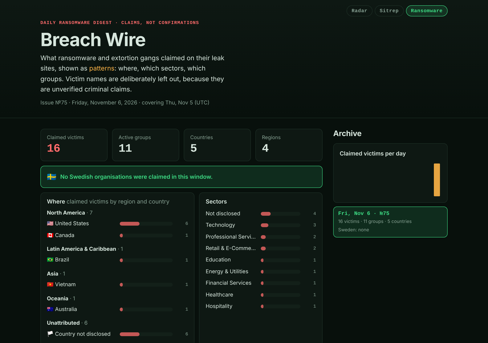

# Verification report: Breach Wire section

| | |
|---|---|
| **Spec** | [spec.md](./spec.md) |
| **Verified** | 2026-11-06 |
| **Test suite** | 91 Python tests (21 KEV + 32 Sitrep + 38 Breach Wire) + 46 JavaScript tests, all passing; `add_breachwire.py --check` OK |
| **Browser** | Headless Chrome (1280 px and 360 px, dark and light) + the live site in the desktop browser pane |

## Acceptance criteria

| AC | Result | Evidence |
|---|---|---|
| **AC-1** Issue appears with no human action | ⏳ Pending | First live publisher run in progress (fired 2026-11-06 22:15 CET) |
| **AC-2** Stats, Sweden, regions, sectors, ledger, data quality match the email | ✅ Pass | Issue №75 page: 16 / 11 / 5 / 4; Sweden clear; North America 7 (US 6, Canada 1), Latin America 1, Asia 1, Oceania 1, Unattributed 6; 9 sectors; 11 groups (Akira 4 first); reconciliation "16 + 9 + 2 + 0 = 27"; both sources OK with 24 / 23 records, all as in the email |
| **AC-3** No victim names anywhere | ✅ Pass (tests + seed) · ⏳ live run | The format has no victim field. `NameGuard`: 7 tests (name in profile, sector or countries; case, punctuation and accents ignored; whole words only; list required; list must cover every victim). Seed of №75 ran the guard with the **real** 21 names (scratch file only); scan of `site/`, `tests/`, `scripts/` and `specs/` for those names: **0 matches** |
| **AC-4** Inconsistent numbers refused | ✅ Pass | `Consistency`: 11 tests (country, sector and group sums, group/country/region counts, reconciliation, Sweden, zero-hit groups, quality > victims, window ≥ date) |
| **AC-5** Multi-part / corrected issue | ⏳ Pending | Live catch-up of 5 Nov (sent as 4 parts plus a "(corrected)" resend) |
| **AC-6** Invalid data refused, nothing written | ✅ Pass | `Refused`: 10 tests incl. unknown fields, unknown region, booleans as numbers, links and domains (leak-site, masked `ne*****h.com`, `.onion`), oversized text |
| **AC-7** Hostile text renders as text | ✅ Pass | Browser: `<script>`, ``, `<b>`, `<i>` shown literally; **0** injected elements, **0** alerts ([screenshot](./evidence/bw-xss.png)) |
| **AC-8** Republishing changes nothing | ✅ Pass | `Idempotent.test_byte_identical` |
| **AC-9** Only the owner's own sent emails | ✅ Pass (task definition) · ⏳ live run | Publisher searches `in:sent from:me` and requires the owner's own address as sender |
| **AC-10** Email task unchanged | ✅ Pass | "Threat Intel - Ransomware" task not modified (same prompt and `30 6 * * *` schedule) |
| **AC-11** KEV "known ransomware use" panel + homepage teaser | ✅ Pass | Panel: "361 vulnerabilities … confirmed as used by ransomware", 8 newest listed; clicking the first opened its Radar detail. Homepage teaser: "Breach Wire №75 · Fri, Nov 6", "Sweden: none", "16 claimed victims across 5 countries, posted by 11 groups." |
| **AC-12** `?d=` and archive | ✅ Pass | `?d=2026-01-01` and `?d=../data/kev` show a friendly notice, the latest issue, and **no** unexpected file requests |
| **AC-13** 360 px, CSP, 0 external requests | ✅ Pass | `scrollWidth − clientWidth = 0` on all three pages (dark and light); CSP test covers `site/ransomware/index.html` automatically; 0 external requests, 0 console errors |

