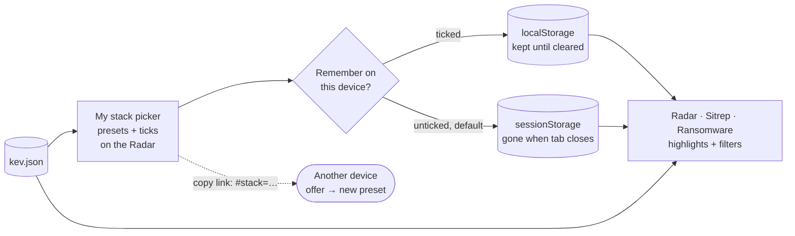

# Implementation plan: My stack

| | |
|---|---|
| **Spec** | [spec.md](./spec.md) |
| **Status** | Draft v2 (presets added), awaiting owner review |

## 1. The big picture

Everything happens in the visitor's browser. **No new data files, no pipeline
changes, no Python.** All three pages already load `kev.json`, which is all the
feature needs.



## 2. Key choices

| Choice | Why | Traces to |
|---|---|---|
| **`localStorage` vs `sessionStorage`**, chosen by the Remember tickbox | Same API, different lifetime: localStorage survives restarts, sessionStorage dies with the tab. Neither is ever sent to a server (unlike cookies) | FR-4, FR-8 |
| **Remember defaults to off** | Nothing lands on a visitor's device until they ask; the cleanest position under EU rules on device storage | FR-4 |
| **One record holds everything** (`threat-radar.presets.v1`) | Remember on = that record exists in localStorage. Off = it exists only in sessionStorage. "Forget everything" = delete it from both | FR-4, FR-7 |
| **Share link uses the `#` fragment** | Browsers don't send the part after `#` to the server, so the stack isn't in GitHub's logs either | FR-13 |
| **Shared stacks become a new preset** | Clicking a link can never destroy something you saved | FR-13 |
| **The picker lives on the Radar**; other pages show "Your stack: <preset> · edit" linking to `../#mystack` | One picker to build and test; the Radar already loads everything it needs | FR-1 |
| **All logic in pure functions** (`stack-logic.js`, `presets.js`) with storage injected | Testable without a browser, like `stats.js` | AC-3, AC-5, AC-12 |
| **Never `window.confirm` or `prompt`**; in-page banners and inputs instead | Consistent styling, no blocking dialogs | FR-5, FR-13 |

## 3. Data shapes

**Presets record** (key `threat-radar.presets.v1`, in localStorage when remembered, otherwise sessionStorage)
```json
{
  "v": 1,
  "active": "Customer A",
  "lastSeen": "2026-11-08",
  "presets": [
    { "name": "Work",       "myStackOnly": true,  "vendors": { "Microsoft": ["Windows", "Exchange Server"], "Fortinet": [] } },
    { "name": "Customer A", "myStackOnly": false, "vendors": { "Cisco": [], "Citrix": ["NetScaler"] } }
  ]
}
```
- An empty product list means "all products of this vendor".
- `lastSeen` is only kept when remembered. On each Radar visit, the previous
  value drives "new since last visit", and then it is replaced with today's date.
- Presets are an ordered list, so the dropdown order is stable.

**Share link**: `https://…/#stack=` + URL-encoded JSON of the active preset's `vendors`.

**Validation limits**: at most 20 presets; names 1–40 characters, unique,
no control characters; per preset at most 300 vendors and 50 products per vendor;
vendor and product names 1–120 characters. Anything invalid means the whole
record is ignored (the page starts fresh) rather than half-loaded.

## 4. Code

**`site/stack-logic.js`** (pure)

| Function | Does |
|---|---|
| `vendorIndex(kev)` | `[{vendor, count, products: [{product, count}]}]`, sorted by count |
| `searchIndex(index, query)` | Vendors whose name **or any product name** matches |
| `inStack(entry, vendors)` | Vendor ticked and (all products, or the product is listed) |
| `stackSummary(kev, vendors, today, lastSeen)` | `{ inCatalog, last30, newSinceLastVisit, ransomware }` |
| `staleNames(vendors, index)` | Ticked names not in the current catalog |
| `mentionedVendors(text, vendors)` | Ticked vendors named in a text (whole word) |
| `encodeShare(vendors)` / `decodeShare(hash)` | The `#stack=` round trip, validated |

**`site/presets.js`** (pure: every function takes a record and returns a new one)

| Function | Does |
|---|---|
| `emptyRecord()` | One preset "My stack", empty |
| `parseRecord(text)` | Strict validation; returns a record or `null`; never throws |
| `activePreset(record)` | The active preset |
| `saveAs(record, name)`, `rename(record, old, new)`, `remove(record, name)`, `switchTo(record, name)` | Preset operations; return `{record}` or `{error}` (duplicate, empty, too long, last preset) |
| `setVendors(record, vendors)`, `setMyStackOnly(record, on)` | Update the active preset |
| `addShared(record, vendors)` | Adds "Shared stack" / "Shared stack 2" … |
| `touchLastSeen(record, today)` | Returns `{ previous, record }` |

**`site/stack-store.js`** (the only file that touches storage)
- `load()` checks localStorage first (remembered), then sessionStorage.
- `save(record, remember)` writes to the chosen storage and **removes the key from the other one**.
- `forget()` removes the key from both.
- Every access is wrapped in try/catch, with an in-memory fallback, and reports `available: false` when storage is blocked.

## 5. UI changes

| Page | Change |
|---|---|
| **Radar** | "My stack (N)" button in the controls → `<dialog>` picker. Top: preset dropdown, "Save as…", "Rename", "Delete" (inline name input with validation messages). Middle: search, vendor rows with a tick and an expander for products, counts, "not in current catalog" notes. Bottom: **☐ Remember on this device** ("Untick on shared computers"), "Copy link to this preset", "Forget everything on this device". "My stack only" toggle in the controls (saved per preset). Summary strip above the list. "Your stack" badge on rows. Highlight ring on matching blips. `#mystack` opens the picker. Share-link offer banner. |
| **Sitrep** | "Your stack" tag on in-stack KEV CVE chips; "Mentions X" tag on items; "Your stack: <preset> · edit" line |
| **Ransomware** | Highlight in-stack KEV entries; "N of your stack's entries are known ransomware use"; stack line with edit link |
| **All** | Footer: "Your stack is kept only in this browser, and only if you tick Remember." |

## 6. Tests first

| Test | Proves |
|---|---|
| `tests/stack.test.mjs`: index, search (incl. vmware → Broadcom), matching, summary with fixed dates, stale names, mentions ("Apple" ≠ "Pineapple"), share round trip | AC-1–3, AC-9, AC-10 |
| `tests/presets.test.mjs`: create, switch, rename, delete, duplicate/empty/too-long names, last-preset protection, shared-preset naming, lastSeen, hostile records (bad JSON, 500 presets, markup, wrong types) | AC-5, AC-11, AC-12 |
| `tests/stack-store.test.mjs` with fake storages: remember on/off moves the record between storages and deletes the other copy; forget clears both; a throwing storage falls back to memory | AC-4, AC-6, AC-7 |
| `site.test.mjs` already scans every new JS file for HTML-injection APIs | AC-12, AC-13 |
| Browser: remember on → close tab → reopen → back; remember off → new tab → gone; unticking clears localStorage; forget; storage blocked; requests and cookies contain no stack data; share link → new preset; 360 px; keyboard | AC-4–8, AC-11, AC-13 |

## 7. Risks

| Risk | Mitigation |
|---|---|
| CISA renames a vendor (as with VMware → Broadcom) | Product-name search plus "not in current catalog" notes, so nothing disappears silently |
| A crafted share link | Validated, size-capped, rendered as text, and only ever **added** as a new preset after a click |
| A corrupted or tampered record in storage | Whole record ignored and the page starts fresh; never half-loaded |
| Visitor expects revisit to work but never ticked Remember | When a stack exists and Remember is off, the picker shows a gentle hint: "Tick Remember to keep this for next time" |
| Sitrep vendor-mention tags give false positives | Labelled "Mentions …", not "Affects …"; whole-word matching only |
