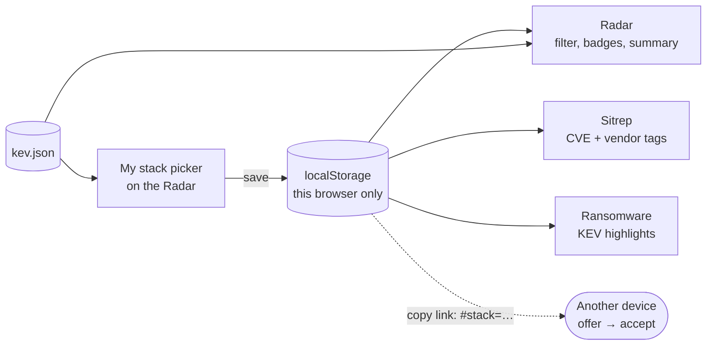

# Implementation plan: My stack

| | |
|---|---|
| **Spec** | [spec.md](./spec.md) |
| **Status** | Draft, awaiting owner review |

## 1. The big picture

Everything happens in the visitor's browser. **No new data files, no pipeline
changes, no Python.** All three pages already load `kev.json`, which is all the
feature needs.



## 2. Key choices

| Choice | Why | Traces to |
|---|---|---|
| **`localStorage`**, not cookies | Cookies are sent to the server with every request; localStorage never leaves the device | FR-5 |
| **Share link uses the `#` fragment** | Browsers don't send the part after `#` to the server, so the stack isn't in GitHub's logs either | FR-9 |
| **Exact KEV names** for vendors and products | KEV is the only source of truth for matching; search covers renames like VMware → Broadcom | FR-2, FR-3 |
| **The picker lives on the Radar**; other pages show "Your stack: … · edit" linking to `../#mystack` | One picker to build and test; the Radar already loads everything it needs | FR-1 |
| **All logic in pure functions** (`stack-logic.js`) with storage injected | Testable without a browser, like `stats.js` | AC-3, AC-9 |
| **Never `window.confirm`** for the share offer; an in-page banner instead | Consistent styling, and no blocking dialogs | FR-9 |

## 3. Data shapes

**Stored stack** (`localStorage["threat-radar.stack.v1"]`)
```json
{ "v": 1, "vendors": { "Microsoft": ["Windows", "Exchange Server"], "Fortinet": [] } }
```
An empty product list means "all products of this vendor".

**Last visit** (`localStorage["threat-radar.lastSeen.v1"]`): `"2026-11-08"`. On
each Radar visit the previous value is read (for "new since last visit") and
then replaced with today's date.

**Share link**: `https://…/#stack=` + URL-encoded JSON of `vendors`.

**Validation limits** (`parseStack`): must be an object of vendor → array of
strings; at most 300 vendors and 50 products per vendor; names 1–120 characters
with no control characters; anything else means the whole value is ignored.

## 4. Pure functions (`site/stack-logic.js`)

| Function | Does |
|---|---|
| `vendorIndex(kev)` | `[{vendor, count, products: [{product, count}]}]`, sorted by count |
| `searchIndex(index, query)` | Vendors whose name **or any product name** matches |
| `parseStack(text)` / `serializeStack(stack)` | Strict validation; never throws |
| `inStack(entry, stack)` | Vendor ticked and (all products, or the product is listed) |
| `stackSummary(kev, stack, today, lastSeen)` | `{ inCatalog, last30, newSinceLastVisit, ransomware }` |
| `staleNames(stack, index)` | Ticked names that aren't in the current catalog |
| `mentionedVendors(text, stack)` | Ticked vendors named in a text (whole word, case-insensitive) |
| `encodeShare(stack)` / `decodeShare(hash)` | The `#stack=` round trip |

`site/stack-store.js` wraps `localStorage` in try/catch and falls back to memory (FR-4).

## 5. UI changes

| Page | Change |
|---|---|
| **Radar** | "My stack (N)" button in the controls → `<dialog>` picker (search, vendor rows with a tick and an expander for products, counts, "not in current catalog" notes, "Copy my stack link", "Clear"). "My stack only" toggle. Summary strip above the list. "Your stack" badge on rows. Highlight ring on matching blips. `#mystack` opens the picker. Share-link offer banner. |
| **Sitrep** | "Your stack" tag on in-stack KEV CVE chips; "Mentions X" tag on items; a stack line with an edit link |
| **Ransomware** | Highlight in-stack KEV entries; "N of your stack's entries are known ransomware use"; stack line with edit link |
| **All** | Footer: "Your stack is saved only in this browser." |

## 6. Tests first

| Test | Proves |
|---|---|
| `tests/stack.test.mjs`: index, search (incl. vmware → Broadcom), matching, summary with fixed dates, stale names, mentions (whole word: "Apple" ≠ "Pineapple"), share round trip | AC-1–3, AC-6, AC-7 |
| Hostile inputs to `parseStack` / `decodeShare`: bad JSON, arrays, huge lists, control chars, markup | AC-9 |
| `site.test.mjs` already scans every new JS file for HTML-injection APIs | AC-9, AC-10 |
| Browser: tick → reload → persists; storage blocked → no errors; requests and cookies contain no stack data; share link offer → accept; 360 px; keyboard | AC-4, AC-5, AC-8, AC-10 |

## 7. Risks

| Risk | Mitigation |
|---|---|
| CISA renames a vendor (as with VMware → Broadcom) | Product-name search plus "not in current catalog" notes, so nothing disappears silently |
| A crafted share link | Validated, size-capped, rendered as text, applied only after the visitor clicks "Use this stack" |
| Vendor-mention tags on the Sitrep give false positives (e.g. "Linux" in passing) | Labelled "Mentions …", not "Affects …"; whole-word matching only |
